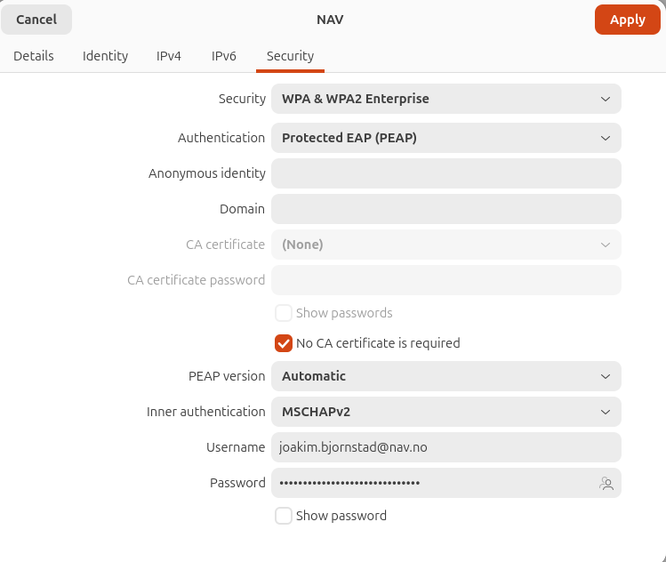
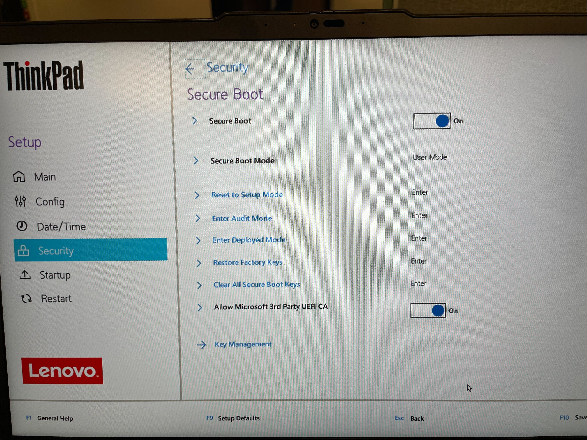

## Hvilken Linux-distribusjon bør jeg velge?
Vi anbefaler den nyeste Ubuntu LTS-versjonen med skrivebordsmiljøet GNOME, siden dette er den eneste varianten som støttes offisielt.

## Hvordan kobler jeg meg til det trådløse nettverket «NAV» i Fyrstikkalléen 1?
Fyll inn informasjonen som vist i skjermbildet nedenfor:



## Hvordan skriver jeg ut i Fyrstikkalléen 1?
[skrive ut](https://github.com/navikt/ny-i-nav/blob/main/ny-unix.md#skrive-ut)

[legge til printer script](
https://github.com/navikt/ny-i-nav/blob/main/add_nav_printers.sh)


## Hvor finner jeg andre nyttige ressurser?
[ny-unix](https://navikt.github.io/ny-i-nav/ny-unix)


## Hvordan setter jeg opp Ubuntu på en Lenovo ThinkPad P16s G4?
UEFI BIOS-versjon: R2XET35W (1.15)
Denne maskinen leveres uten operativsystem.
Før du begynner:

- Ha en USB-minnepinne med den nyeste Ubuntu LTS-versjonen klar (Service Desk i Fyrstikkalléen 1 kan låne ut tomme USB-minnepinner).

> [!CAUTION]
> Før du installerer Linux på den bærbare maskinen, må du aktivere Secure Boot.

Fremgangsmåte:
1. Slå på maskinen.
2. Trykk ENTER for å avbryte oppstarten når Lenovo-logoen vises.
3. Trykk F1 for å åpne BIOS-oppsettet.
4. Gå til menyen Security :arrow_right: Secure Boot (se bildet).
   
    1. Sett Secure Boot til On.
    2. Sett Allow Microsoft 3rd Party UEFI CA til On.
    3. Velg Exit Deployed Mode (Secure Boot Mode skal være User Mode).


5. Trykk F10 for å lagre og avslutte (Save and Exit).
6. Sett inn minnepinnen med den nyeste Ubuntu LTS-versjonen, og start maskinen fra den.
7. Velg Try Ubuntu i oppstartsmenyen til Ubuntu.
8. Trykk CTRL+ALT+T for å åpne terminalen.
9. Kontroller at Secure Boot er aktivert:
```
ubuntu@ubuntu:~$ sudo mokutil --sb-state 
SecureBoot enabled
```
10. Start installasjonen av Ubuntu.
11. Installer Ubuntu med [full diskkryptering (FDE)](https://documentation.ubuntu.com/security/security-features/storage/encryption-full-disk/).
    1. «Encrypt with passphrase» passer for de fleste.
    2. [«Use hardware-backed encryption»](https://ubuntu.com/desktop/docs/en/latest/explanation/hardware-backed-disk-encryption/) kan brukes hvis du får det til å fungere.
12. Fullfør de øvrige installasjonstrinnene.
13. Når installasjonen av Ubuntu er fullført og maskinen er startet på nytt, kontrollerer du i terminalen at Secure Boot er aktivert:
```
bruker@maskin:~$ sudo dmesg | grep -i secureboot
[sudo: authenticate] Password: 
[    0.000000] secureboot: Secure boot enabled
[    0.003709] secureboot: Secure boot enabled
```
14. Installer naisdevice, og kontroller at alle kravene i Kolide er oppfylt: [install naisdevice](https://doc.nais.io/operate/naisdevice/how-to/install/)
15. Koble til naisdevice. Du skal nå ha tilgang til Navs ressurser fra Ubuntu.
16. Kontroller at Outlook fungerer: [outlook mail](https://outlook.office365.com/mail/)


## Pakkebrønn for enklere installasjon og oppdatering av Zoom
```
# 0. Installer nødvendige pakker
sudo apt-get install ca-certificates curl apt-transport-https gnupg

# 1. Legg til signeringsnøkkelen for pakkebrønnen
curl -sfSL "https://europe-north1-apt.pkg.dev/doc/repo-signing-key.gpg" | sudo dd of="/etc/apt/keyrings/nais-ppa-zoom.asc"

# 2. Legg til pakkebrønnen
echo "deb [signed-by=/etc/apt/keyrings/nais-ppa-zoom.asc] https://europe-north1-apt.pkg.dev/projects/nais-ppa zoom main" | sudo tee /etc/apt/sources.list.d/nais-ppa-zoom.list

# 3. Oppdater pakkelisten
sudo apt update

# 4. Installer Zoom
sudo apt install zoom
```
